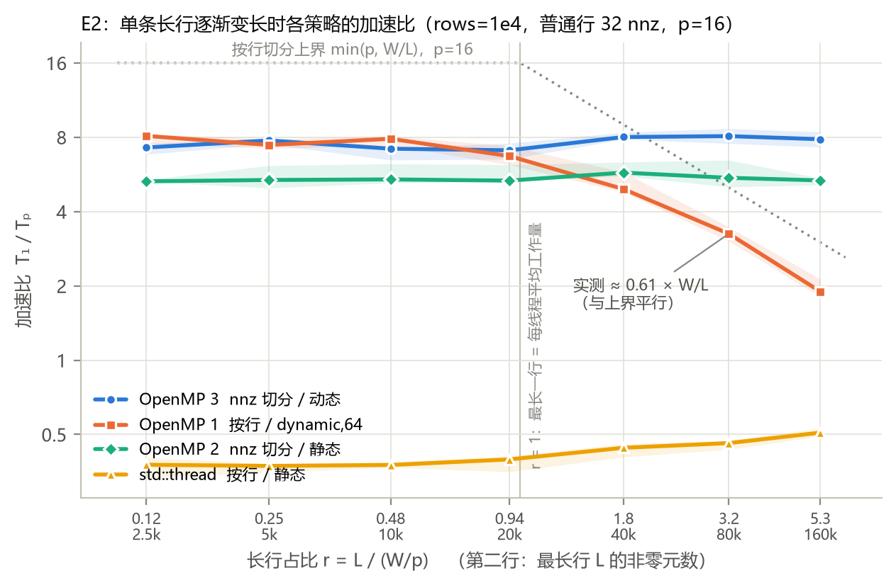
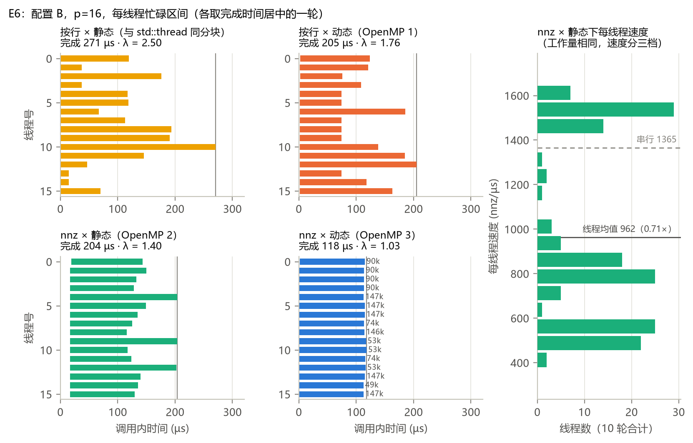
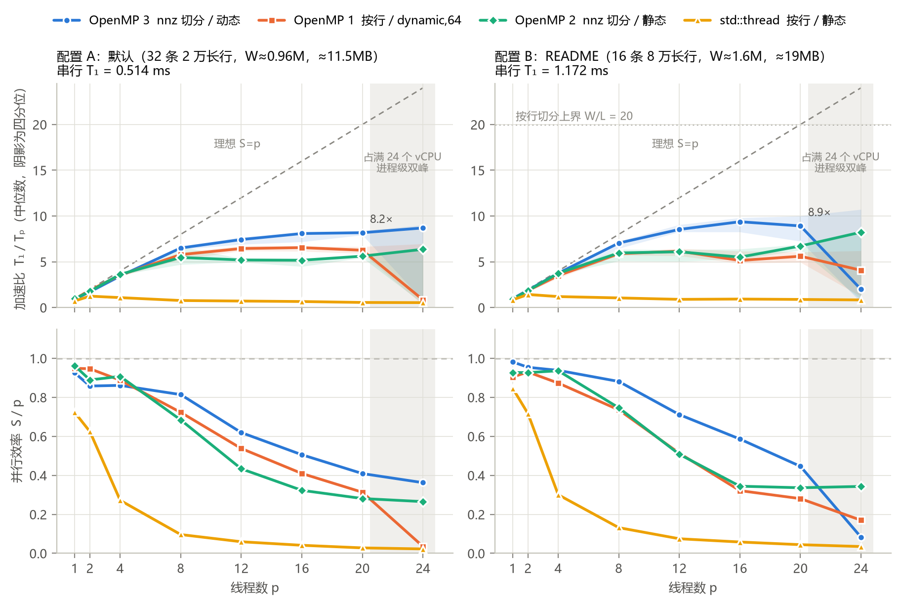
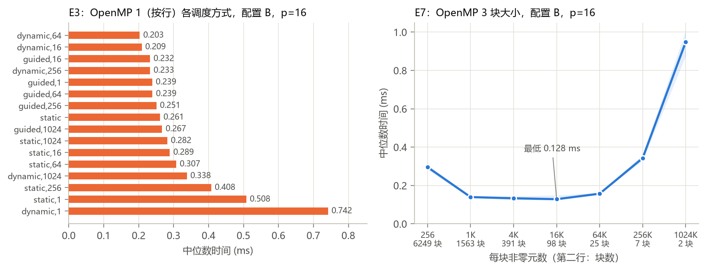
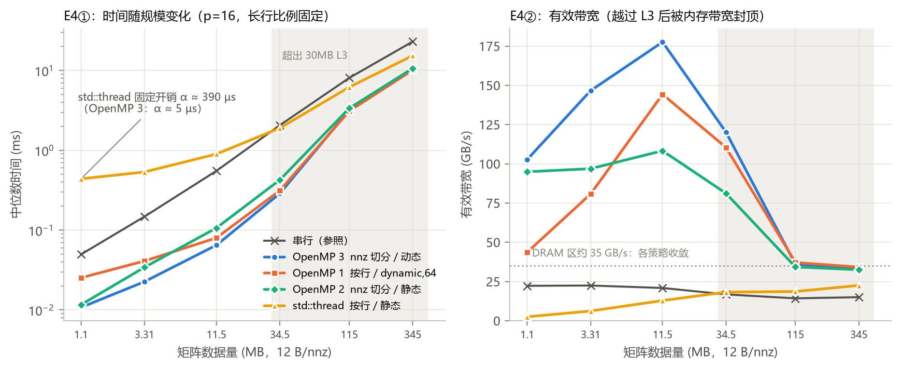
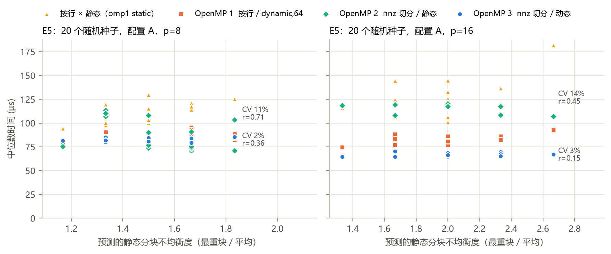
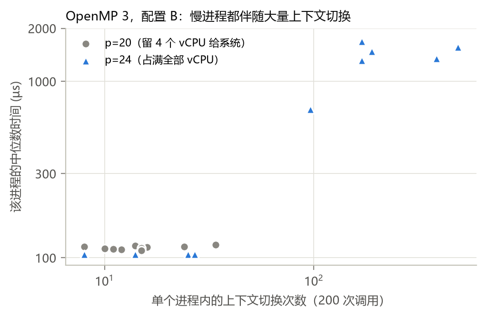

\begin{center}
{\Large\bfseries 实验一：OpenMP CSR SpMV 并行编程　实验报告}\\[3pt]
姓名：＿＿＿＿＿　　学号：＿＿＿＿＿　　2026 年 10 月
\end{center}

**摘要**　本实验先根据矩阵结构推出各类策略的性能上界，再用实验去证实或推翻这些预测。策略按 **切分粒度（按行 / 按非零元）× 分配方式（静态 / 动态）** 组成 2×2 析因设计，注册 3 个 OpenMP 函数。实验证实了两点：长行把按行切分的加速比压在 $W/L$ 以下；本机（i7-14650HX，8P+8E，运行在 WSL2 中）的线程速度相差约 3 倍，且无法事先知道哪个线程快。**OpenMP 3**（按非零元切分 + 动态领取）同时解决了这两个问题。它在两个基准配置上 p=16 时的加速比分别为 8.1 倍和 9.4 倍，20 个随机种子间的波动只有 2–3%，是最终方案。

# 1　策略设计与预测

记 $W$ 为非零元总数，$L$ 为最长一行的非零元数，$p$ 为线程数。三个代表性配置如表 1，其中 C 是为检验上界而专门构造的极端配置。

| 配置 | rows × cols | 长行 | $W$ | $L$ | $W/L$ | 长行工作占比 | 数据量 |
|---|---|---|---|---|---|---|---|
| A 默认 | 1e4 × 1e5 | 32 条 | 958,976 | 20,000 | 47.9 | 67% | 11.5 MB |
| B README | 2e4 × 2e5 | 16 条 | 1,599,744 | 80,000 | 20.0 | 80% | 19.2 MB |
| C 极端（E2 的一个点） | 1e4 × 2e5 | 1 条 | 419,968 | 100,000 | 4.2 | 24% | 5.0 MB |

: 矩阵配置（数据量按每个非零元 12 B 计算，均小于 30 MB 的 L3）。

| | **静态分配** | **动态分配** |
|---|---|---|
| **按行切分** | `omp1 --sched static`（与 std::thread 分块相同，只作对照） | **OpenMP 1**：`schedule(runtime)`，默认 `dynamic,64` |
| **按非零元切分** | **OpenMP 2**：nnz 均分成 p 段 | **OpenMP 3**：每 4096 个 nnz 一块，`schedule(dynamic,1)` |

: 2×2 析因设计。左上格与 std::thread 基线的分块方式相同，两者的时间差只来自线程管理。

**按非零元切分的实现**（OpenMP 2、3 共用 `spmv_nnz_segment`）：每个区间先用二分查找在 `row_ptr` 上定位起始行；起点落在本区间内的行由本区间写 `y[r]`，最后一个区间取闭区间，以便末尾的空行也有归属；区间开头若落在一条更早开始的行中间，这段部分和记入 `carry[seg]`，并行区结束后按区间顺序串行加回去。这样每个 `y[r]` 只被写一次，不存在数据竞争，结果可以复现；代价是长行的浮点累加顺序改变了（误差见 §2）。

**上界模型与预测。** 按行切分时，任何调度都不可能快于 $\max(W/p,L)$，因此加速比 $S_{\text{row}}\le\min(p,W/L)$。按行动态调度属于贪心表调度，由 Graham 界，完成时间 $\le W/p+(1-1/p)L$。按非零元切分不受 $L$ 限制。由此给出可以被实验否定的预测：

- **P1**：长行占比 $r=L/(W/p)>1$ 时，OpenMP 1 的加速比随 $W/L$ 下降，而 OpenMP 2、3 不受影响。
- **P2**：$r<1$ 时，OpenMP 1 与按非零元切分的策略相当。
- **P3**（E1 之后补充）：本机线程速度不一致，静态均分即使工作量相同，完成时间也会不均；动态领取可以补偿。

# 2　实验环境、公平性与正确性

**环境**：Intel i7-14650HX（8P+8E，16 核 24 线程，L3 30 MB；WSL2 把拓扑显示成同构的 12 核×2）；WSL2 2.5.9，内核 6.6.87.2，宿主 Windows 11；g++ 13.3.0，所有策略统一用 `-O2 -std=c++17 -fopenmp -pthread`；插电，电源模式为"最佳性能"；`OMP_PROC_BIND=close OMP_PLACES=cores`。

**公平性**：每个策略单独开一个进程运行（新增 `--only` 选项），每个点跑 10 轮。进程内先调用一次作为 warm-up 并做正确性检查，再计时 10 次取中位数；报告中的数值是 10 个进程中位数的中位数。加速比统一为 $T_1/T_p$，$T_1$ 取 `spmv_serial` 的时间。*踩过的坑*：第一版把串行任务集中放在最后跑，芯片已经发热、睿频下降，$T_1$ 被高估约 20%，效率超过 1；改为每轮把全部任务用固定种子随机打乱后，问题消失。

**正确性（E0）**：覆盖线程数 {1,2,3,4,7,8,13,16,24} × 3 个种子 × 10 类矩阵，包括无长行、普通行为空、全空、全是长行、单行、nnz 少于线程数，以及块大小为 1 或超过 nnz 等边界；另用 ASan/UBSan 构建跑了一个子集。共 527 次运行，全部通过。按行切分的策略与串行结果逐位相同；按非零元切分的最大绝对误差为 1.6e-12，约为容差的 1/400。测试中还发现 starter 的测试框架有一个隐患：各策略共用同一个输出数组，漏写的行会沿用上一个策略的正确值而通过检查。现在每个策略检查前先把输出填成 1e300（不能用 NaN：`NaN > tol` 为假，检查反而会放过错误）；`check_result` 没有改动。运行截图见附录 F。

# 3　验证预测

## 3.1　P1、P2：长行上界（E2）

{width=62%}

**P1 成立**：$r>1$ 后，OpenMP 1 的加速比依次为 4.93、3.25、1.90，与上界平行下降，实测与 $W/L$ 之比稳定在 **0.61**。OpenMP 3 始终保持在 7.1–8.1，OpenMP 2 保持在 5.3–5.8。**P2 成立**：$r\le0.48$ 时，OpenMP 1 与 OpenMP 3 相当，甚至略好（7.4–8.1 对 7.2–7.8）：长行不构成瓶颈时，按非零元切分的定位和 carry 合并开销反而显现出来。为什么是 0.61 而不是 1，由 E6 回答。

## 3.2　P3：线程速度异构（E6，每线程 breakdown）

用 `-DSPMV_TRACE` 编译插桩版本，记录每个线程开始和结束的时刻、所在 CPU 以及处理的非零元数。完成时间不均衡度定义为 $\lambda$ = 最晚结束时间 / 平均结束时间。

{width=96%}

| 格子 | 按行×静态 | 按行×动态 | nnz×静态 | **nnz×动态** |
|---|---|---|---|---|
| $\lambda$（p=16 / p=20） | 2.23 / 2.46 | 1.60 / 1.90 | 1.58 / 1.53 | **1.03 / 1.04** |
| 完成时间 µs（p=16） | 267 | 205 | 204 | **118** |

: E6 的完成时间不均衡度，取 10 轮中位数。

**P3 成立。**

- OpenMP 2 的每个线程都分到 99,984 个非零元，处理速度却分成三档，约 500、820、1550 nnz/µs，相差约 3 倍；串行速度为 1365 nnz/µs。
- OpenMP 3 让快线程多领块（14.7 万对 4.9 万个非零元），各线程几乎同时结束。
- 同一个 vCPU 在不同运行中快、中、慢三档都出现过，说明宿主机会重新映射 vCPU 和物理核，线程速度无法事先确定。因此按速度加权的静态分配也不可行，只能在运行时动态均衡。
- 线程平均速度只有串行的 0.71 倍，而长行由某一个线程处理，这就解释了 E2 中的 0.61。
- 2×2 设计据此把两种效应拆开：**按非零元切分**解决了长行问题（OpenMP 2、3 不随 $L$ 变化）；**动态领取**解决了速度不一致问题（OpenMP 3 在每个 $L$ 下都比 OpenMP 2 高 33–47%）。

## 3.3　线程扩展性（E1）与 p=24 现象

{width=76%}

- **OpenMP 3 扩展得最好**：p=16 时配置 A 为 8.09 倍，配置 B 为 9.38 倍。
- **OpenMP 1 在配置 B 上提前饱和**：从 p=8 起停在 5–6 倍，因为 Graham 界中的 $L$ 项不随 p 减小。
- **效率随 p 下降**：除了负载不均，后加入的线程更多落在 E 核或与超线程兄弟共用一个 P 核上（p=20 时线程平均速度降到串行的 0.59 倍），另外还有 fork/join 开销。
- **有趣现象：p=24 时约一半进程整体变慢 10–50 倍。** perf 逐进程计数显示，慢进程有 96–487 次上下文切换，快进程只有 8–27 次（附录 D）。原因是 OpenMP 线程占满了全部 vCPU，后台进程只能抢占某个正在自旋的线程，整个并行区都被拖慢。改用 `OMP_WAIT_POLICY=PASSIVE` 后双峰消失，但每次调用多出约 0.3–0.4 ms 的唤醒开销。因此主结论只取到 p=20。

## 3.4　消融与负优化（E3、E7，附录 B）

**按行切分的调度方式**（配置 B，p=16）：`dynamic,64` 最好，0.203 ms；`static` 为 0.261 ms，`guided` 为 0.23–0.27 ms。两个负优化：`dynamic,1` 最慢，0.742 ms（2 万行要做 2 万次原子领取）；`static,1` 为 0.508 ms（相邻行交给不同线程，写 `y` 时产生伪共享）。

**OpenMP 3 的块大小**呈 U 形：在 1K–16K 之间基本持平（0.128–0.139 ms）；块为 256 时时间翻倍（0.296 ms）；块数接近线程数时急剧变慢（7 块时为 0.343 ms）。默认取 4096：只要 $W\ge0.8$M，在 p=20 下每个线程仍能分到约 10 块。

# 4　OpenMP 与 std::thread

**固定开销。** 在规模扫描 E4 中，只用数据量小于 L3 的点拟合 $T=\alpha+\beta W$，得到 std::thread 的固定开销 **α ≈ 390 µs**，OpenMP 只有 3–22 µs。std::thread 基线每次调用都要创建并回收 16 个线程，平均每个约 24 µs。默认矩阵串行只需 0.51 ms，所以在配置 A 上，std::thread 从 p=8 起反而比串行更慢。perf 印证了这一点（表 4）：它每次调用有 24 次缺页（新线程栈第一次被访问）、7.7 次上下文切换和约 0.3 ms 内核态时间。

**数据超出 L3 后**（115 MB、345 MB），各 OpenMP 策略都收敛到约 2.3 倍，有效带宽约 34 GB/s；std::thread 的开销被摊薄，可达 1.3–1.5 倍（附录 C）。

**适用场景。** 两者都适合"各行独立计算"的 SpMV。OpenMP 用一行 pragma 就完成了并行循环、调度切换（`schedule(runtime)` 让 E3 的消融不必重新编译）和线程数控制，并且复用线程池。std::thread 的优势在于可以自定义线程的生命周期，适合常驻工作线程、任务队列、流水线、线程间通信，以及需要把特定任务绑定到特定线程的场景。如果把基线改成常驻线程池，它的 α 也能降到与 OpenMP 同一量级。

# 5　perf 分析

WSL2 不暴露硬件 PMU（cycles、instructions、cache-misses 都显示 `<not supported>`），因此只能使用软件事件，并把 `perf_event_paranoid` 临时放宽到 1，否则上下文切换的计数会被过滤成 0。starter 的示例命令会把矩阵生成和参考解也计入计数器，本实验改用**差分法**：同一命令分别以 `--repeats 20` 和 `--repeats 220` 运行（各 `perf stat -r 5`），两者之差除以 200 就是单次 SpMV 的计数。

| 策略（配置 B，p=16） | 墙钟 ms | task-clock ms | CPU 利用率 | 上下文切换 | 缺页 |
|---|---|---|---|---|---|
| serial | 1.378 | 1.427 | 1.0 核 | 0.005 | 0 |
| std::thread | 1.332 | 2.130 | 1.6 核 | 7.67 | 24.0 |
| omp1 static（按行×静态） | 0.244 | 3.998 | 16.4 核 | ≈0 | 0 |
| **OpenMP 3** | **0.137** | **2.186** | 16.0 核 | 0.02 | 0 |

: 差分法得到的单次调用计数。

OpenMP 线程完成工作后自旋等待，所以 CPU 利用率接近 p，负载不均表现为"CPU 一直在忙，但做的是无用功"。按 E6 测得的线程平均速度（串行的 0.71 倍）估算，有效工作约为 1.4 / 0.71 ≈ 2.0 ms：按行×静态约有一半 CPU 时间花在屏障前自旋，OpenMP 3 不到 10%。PASSIVE 每次调用有 35 次上下文切换，说明自旋等待是用 CPU 时间换延迟。

# 6　结论、局限与可扩展性

1. 偏斜矩阵上，按行切分的加速比被 $W/L$ 封顶，实测约为 $0.61\,W/L$，预测得到验证。
2. 在 P/E 混合核加虚拟化的环境下，线程速度相差约 3 倍且无法预知，静态均分即使工作量完全相同也做不到负载均衡。
3. **OpenMP 3** 同时解决了以上两点。它在 $r\ge1$ 或 $p\ge8$ 时明显领先；只有在 $r<0.5$、长行影响很小时，比更简单的 OpenMP 1 慢约 10%。种子间的 CV 只有 2–3%（按行×静态为 11–14%），因此作为最终方案。

**局限**：拿不到硬件计数器，无法直接测量缓存未命中和 IPC；vCPU 到物理核的映射被宿主机隐藏，"三档速度分别对应 P 核、超线程共享的 P 核、E 核"只是推断；实验矩阵都是随机生成的，没有在 SuiteSparse 等真实矩阵上验证。

**可扩展性**：在 L3 之内，OpenMP 3 可以扩展到 p=16–20。进入 DRAM 区后瓶颈变成内存带宽（约 34 GB/s），下一步应当减少访存量（例如压缩 `col_idx`、对行重排以提高 `x` 的局部性）。在 p=24 这样占满全部 vCPU 时，需要预留核心给系统，或改用 PASSIVE，以延迟换稳定。

# 7　AI 使用声明与参考资料

**AI 使用声明。** 本实验使用了 Claude（Anthropic 公司，通过 Claude Code 使用 Claude Opus 5.5 模型），用于实现三个 OpenMP 策略和驱动扩展（`--only`、`--csv`、TRACE 插桩等），编写正确性测试、实验网格、绘图和 perf 脚本并运行实验，以及起草本报告。方案决策由本人在三个检查点作出：CP1 保留 2×2 设计，p=24 先做 PASSIVE 对照，主结论只取到 p=20；CP2 选定 OpenMP 1 用 `dynamic,64`、OpenMP 3 块大小用 4096；CP3 以 OpenMP 3 为最终方案，报告采用"预测→验证"主线。数据均可由仓库中的脚本和 `results/*.csv` 复现，并已由本人核对。对话截图见附录 G。心路历程报告由本人独立撰写。

**参考资料**：[1] OpenMP API Specifications, <https://www.openmp.org/specifications/>；[2] GNU libgomp 手册（`OMP_WAIT_POLICY`、`OMP_PROC_BIND`、`OMP_PLACES`），<https://gcc.gnu.org/onlinedocs/libgomp/>；[3] D. Merrill, M. Garland. Merge-Based Parallel Sparse Matrix-Vector Multiplication. SC'16, <https://doi.org/10.1109/SC.2016.57>；[4] R. L. Graham. Bounds on Multiprocessing Timing Anomalies. SIAM J. Appl. Math., 1969, <https://doi.org/10.1137/0117039>；[5] Linux 内核文档 Perf events and tool security，<https://www.kernel.org/doc/html/latest/admin-guide/perf-security.html>；[6] Intel ARK：i7-14650HX 规格，<https://ark.intel.com>。

\newpage

# 附录

## A　E1 完整数据（单元格内依次为：时间 ms / 加速比 / 效率；$T_1$：配置 A 0.514 ms，配置 B 1.172 ms）

**配置 A**

| p | OpenMP 3 | OpenMP 1 | OpenMP 2 | std::thread |
|---|---|---|---|---|
| 1 | 0.556 / 0.93 / 0.93 | 0.542 / 0.95 / 0.95 | 0.535 / 0.96 / 0.96 | 0.712 / 0.72 / 0.72 |
| 2 | 0.300 / 1.72 / 0.86 | 0.272 / 1.89 / 0.95 | 0.289 / 1.78 / 0.89 | 0.412 / 1.25 / 0.62 |
| 4 | 0.149 / 3.44 / 0.86 | 0.145 / 3.55 / 0.89 | 0.142 / 3.63 / 0.91 | 0.473 / 1.09 / 0.27 |
| 8 | 0.079 / 6.51 / 0.81 | 0.089 / 5.78 / 0.72 | 0.094 / 5.47 / 0.68 | 0.667 / 0.77 / 0.10 |
| 12 | 0.069 / 7.43 / 0.62 | 0.080 / 6.45 / 0.54 | 0.099 / 5.20 / 0.43 | 0.722 / 0.71 / 0.06 |
| 16 | 0.064 / 8.09 / 0.51 | 0.079 / 6.55 / 0.41 | 0.100 / 5.17 / 0.32 | 0.778 / 0.66 / 0.04 |
| 20 | 0.063 / 8.18 / 0.41 | 0.082 / 6.26 / 0.31 | 0.091 / 5.62 / 0.28 | 0.922 / 0.56 / 0.03 |
| 24 | 0.059 / 8.70 / 0.36 | 0.607 / 0.85 / 0.04 | 0.081 / 6.36 / 0.27 | 0.950 / 0.54 / 0.02 |

**配置 B**

| p | OpenMP 3 | OpenMP 1 | OpenMP 2 | std::thread |
|---|---|---|---|---|
| 1 | 1.195 / 0.98 / 0.98 | 1.296 / 0.90 / 0.90 | 1.264 / 0.93 / 0.93 | 1.387 / 0.85 / 0.85 |
| 2 | 0.615 / 1.91 / 0.95 | 0.630 / 1.86 / 0.93 | 0.632 / 1.85 / 0.93 | 0.818 / 1.43 / 0.72 |
| 4 | 0.312 / 3.75 / 0.94 | 0.336 / 3.49 / 0.87 | 0.313 / 3.74 / 0.94 | 0.976 / 1.20 / 0.30 |
| 8 | 0.166 / 7.05 / 0.88 | 0.199 / 5.89 / 0.74 | 0.196 / 5.97 / 0.75 | 1.112 / 1.05 / 0.13 |
| 12 | 0.137 / 8.54 / 0.71 | 0.190 / 6.16 / 0.51 | 0.192 / 6.09 / 0.51 | 1.307 / 0.90 / 0.07 |
| 16 | 0.125 / 9.38 / 0.59 | 0.228 / 5.14 / 0.32 | 0.213 / 5.51 / 0.34 | 1.261 / 0.93 / 0.06 |
| 20 | 0.131 / 8.92 / 0.45 | 0.209 / 5.61 / 0.28 | 0.174 / 6.73 / 0.34 | 1.321 / 0.89 / 0.04 |
| 24 | 0.589 / 1.99 / 0.08 | 0.288 / 4.08 / 0.17 | 0.142 / 8.23 / 0.34 | 1.403 / 0.84 / 0.03 |

p=24 一行受 §3.3 所述的抢占双峰影响，数值不稳定，不用于主结论。

## B　消融实验（E3 / E7）

{width=95%}

## C　规模扫描（E4）与种子鲁棒性（E5）

{width=95%}

{width=88%}

E5 中，std::thread 的时间主要由每次创建线程的开销构成（约 0.4 ms），看不出负载不均的影响。因此改用分块方式相同、但没有创建开销的 `omp1 --sched static` 作为"按行×静态"的对照。

## D　p=24 抢占验证

{width=55%}

## E　环境记录与复现

完整的环境信息见 `results/env.txt`，所有命令与原始数据见 `实验日志.md` 和 `results/`。复现方法：

```
g++ -O2 -std=c++17 -fopenmp -pthread csr_spmv_lab.cpp -o csr_spmv_lab
python scripts/check_correctness.py --asan        # E0
python scripts/bench.py e1 --rounds 10            # 其余实验：bind wait e2 e3 e4 e5 e6 e7
python scripts/perf_diff.py run|wait|p24          # 需要 perf_event_paranoid <= 1
python scripts/plot.py                            # 生成全部图表
```

## F　正确性运行截图

（此处插入本人终端运行 `./csr_spmv_lab --threads 16` 的截图，文字版见 `results/correctness_run.txt`。）

## G　AI 对话截图

（此处插入与 Claude 的对话截图。）
