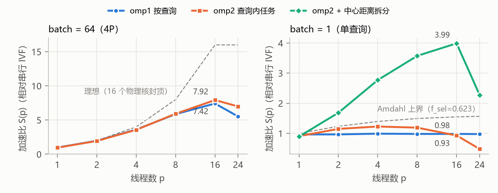
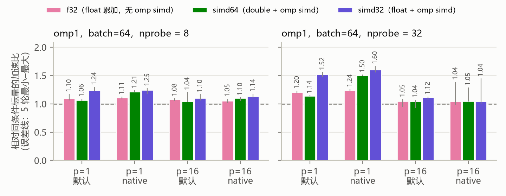
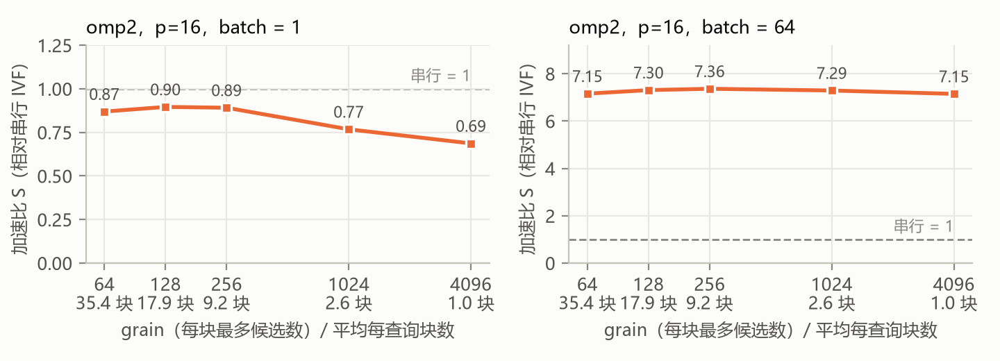
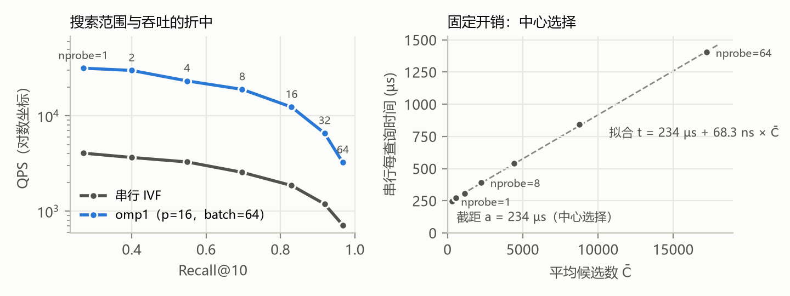
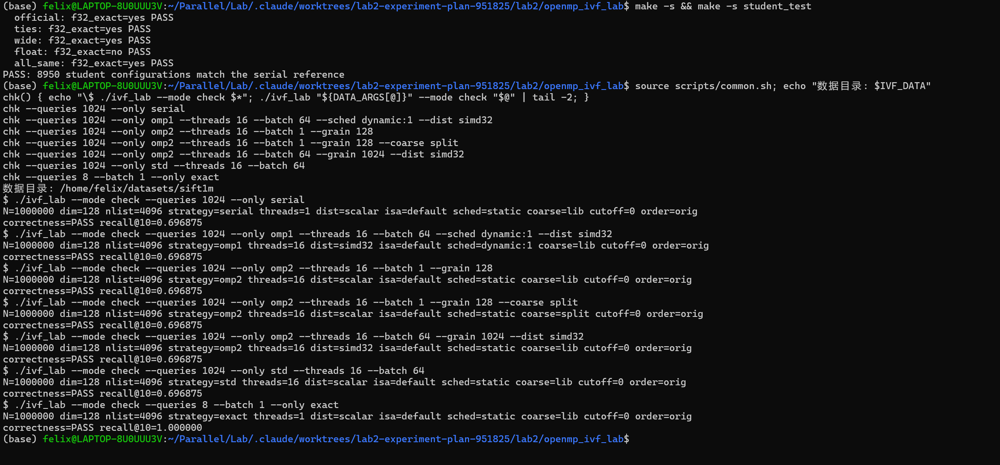
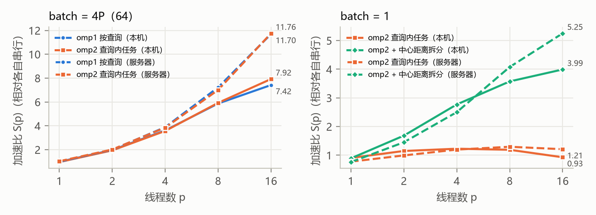

\begin{center}
{\Large\bfseries 实验二：OpenMP IVF-Flat 向量检索　实验报告}\\[3pt]
姓名：杨清徽　　学号：2024201584　　2026 年 11 月
\end{center}

**摘要**　本报告以"一次查询的成本账" $W(q)=a+b\cdot C(q)$ 为主线：$a$ 是与查询无关的中心选择开销，$b\cdot C(q)$ 是候选扫描开销。先实测这笔账，据此写下 8 条带数字的预测（P1–P8），再用 A–F 六组实验逐条检验。两个事实贯穿全部结果：(1) nprobe=8 时中心选择占 62%，它既不能用 SIMD 加速，batch=1 时也只能串行；(2) 本机（i7-14650HX，8P+8E，WSL2）上同时忙碌的线程会互相拖慢，16 线程时约慢 1.8 倍。大 batch 时 16 线程加速比为 7.4–7.9；单查询时，合规的查询内并行最多 1.23，把中心距离也拆成任务后达到 3.99（作为探索）。8 条预测中 2 条成立，5 条部分成立，1 条被推翻。在课程服务器（官方数据与索引）上复现后，大 batch 加速比升到 11.7，本机的并发减速主要来自笔记本硬件；建线程开销则大 8 倍（§4.7）。

# 1　成本账与预测

**数据**：本机没有课程的 `/var/dataset`，于是按课程格式自建：texmex SIFT1M（$N=10^6$，d=128），用 faiss-cpu 1.15.1 在全部库向量上训练 IVF（L=4096）；ground truth 按整数精确距离和 $(distance,id)$ 排序（`--only exact` 的 Recall@10 恰好为 1）。列表长度最短 66、中位数 227、最长 1255；实验取前 Q=1024 个查询，k=10。坐标是 0–218 的整数，前 100 名内有等距的查询占 76%，所以等距在这份数据上是常态。课程服务器上官方数据的 base、query、gt 与自建数据 md5 相同，只有中心和列表编号不同；官方索引上 101 次完整检查全部 PASS，Q=1024、nprobe=8 时 Recall@10 为 0.698（自建 0.697）。**P0 分阶段计时**（单线程，每个查询计时 5 次取中位数）：每算一个中心约 53.5 ns，每扫一个候选约 59.4 ns，二者只差 11%，说明标量 double 距离受累加依赖链限制，是计算瓶颈而非内存瓶颈。

| nprobe | C(q)：中位数 / 最大 / 平均 | 中心选择 (ms) | 扫描 (ms) | $f_{sel}$ |
|------|----------------------|----------|----------|--------|
| 1 | 247 / 1255 / 282 | 223.6 | 17.7 | 0.927 |
| 8 | 2015 / 5704 / 2231 | 224.7 | 135.7 | **0.623** |
| 32 | 8132 / 16022 / 8762 | 231.6 | 542.5 | 0.299 |

: 前 1024 个查询的单线程分阶段墙钟时间（合计）。$f_{sel}$ 为中心选择所占比例。

| # | 预测（依据） | 实测 | 判定 |
|--|------------------------------------|----------------------|----|
| P1 | omp2、batch=1：$S(16)<2$（Amdahl 上界 1.55） | 最高 1.23（p=4），p=16 时 0.93 | 成立 |
| P2 | 中心距离也拆成任务：batch=1 时 $S(16)$ 为 5–10 | 3.99（服务器 5.25） | 部分 |
| P3 | batch=64：$S(16)\approx11$（Lab1：线程速度为串行的 0.71） | 7.4–7.9（服务器 11.7） | 本机推翻，服务器成立 |
| P4 | 按 C(q) 排序后 static：多个 batch 变快，单个 batch 变慢 | 单个 batch 慢 10–16%；多个 batch 在噪声内 | 部分 |
| P5 | 最优 grain：batch=1 呈 U 形；batch=64 越大越快 | 最优 128–256；batch=64 差异 <3% | 部分 |
| P6 | nprobe 从 8 降到 1，QPS 只升 1.4–1.8 倍（固定开销 $a$） | 1.59 | 成立 |
| P7 | SIMD：p=1 时整体快 1.3–1.5 倍；nprobe 越大收益越大；p=16 时不超过 p=1 | 1.24 / 1.52 / 1.04–1.14 | 部分 |
| P8 | std::thread 在 batch=64 时慢 20–30%，随 batch 增大缩小 | +0.29 ms/调用（服务器 +2.2 ms） | 部分 |

: 实验前写入计划的可证伪预测（"部分"指方向对但幅度不符，或只有一半成立）。

# 2　实现

**omp1**：`parallel for schedule(runtime)`，每个查询独立完成全部步骤，团队大小为 $\min(p,\text{batch})$。调度消融（p=16，batch=64）：static 58.4 ms，guided 54.9 ms，**dynamic:1 54.1 ms**（选用）。

**omp2**：每次 batch 调用只建一个团队，由 `parallel`+`single` 为每个查询生成任务 $T_q$。$T_q$ 依次：① 调用公共的 `select_lists`；② 把选中的列表首尾相接成虚拟区间 $[0,C)$，用前缀和 `off[]` 定位；③ 按 grain 切块（块可跨列表，长列表也会被拆开，每个候选恰好计算一次）；④ 用 `taskloop grainsize(1)` 为每块生成任务，块内维护局部 `TopK`，写入 `part[b·k,(b+1)·k)`；⑤ taskloop 的隐式 taskgroup 结束后由 $T_q$ 合并（跳过 id=−1 的填充项）。**每块保留 k 个就够**：若 $e$ 在全局前 k 名，比它更好的元素不超过 $k-1$ 个，块内自然也不超过，故 $e$ 必在本块前 k 名（前提：$(distance,id)$ 为全序、id 唯一）。**数据归属**：`lists`、`off`、`part` 由 $T_q$ 持有；块任务只读前两者，块 $b$ 只写自己的 k 个位置；$T_q$ 在 taskloop 结束后读取，返回时释放。**陷阱**：这些局部变量在嵌套 taskloop 中默认是 firstprivate，会被每块复制一份、写入丢失，所以代码用 `default(none)`，只把裸指针 firstprivate 进去。小任务阈值经消融证明有害（§4.3），因此 cutoff=0。

**omp2+拆分（探索，CP1 决定）**：4096 个中心每 256 个一块拆成任务，仍用公共的 `l2_distance_scalar` 计算，再用同一个全序比较器 `better` 做 `partial_sort`。选出的列表与 `select_lists` 逐项相同、完整检查全部通过，但没有直接调用 `select_lists`，所以正文主表只用 omp2。

**SIMD**：`--dist` 切换 4 种候选距离（取值写入 CSV）：scalar（公共函数，double）、f32（float 累加，无 `omp simd`）、simd64（double + `omp simd reduction`）、simd32（float + `omp simd reduction`）；Top-k 更新放在距离函数之外。float32 是精确的：每项 ≤ $218^2$，128 维之和 ≤ $6.08\times10^6<2^{24}$，且每项非负，任意累加顺序的部分和都是 float 能精确表示的整数，结果与 double 逐位相同；该前提在计时之外检查，不满足就拒绝使用。

**std::thread**：每次调用新建 $\min(p,\text{batch})-1$ 个线程，返回前 join，区间划分与 libgomp 的 static 相同，只用公共的中心选择和标量距离。**omp3**：每个候选都进 `critical` 更新共享 Top-k，作为反面对照。

# 3　环境、比较条件与正确性

**环境**：i7-14650HX（8P+8E，16 核 24 线程，L3 30 MB），WSL2 内核 6.6.87.2，内存 7.6 GiB，g++ 13.3.0 + libgomp，插电、电源模式"最佳性能"；P=16，大 batch 取 4P=64。**编译**：统一 `-O3 -std=c++17 -fopenmp -pthread`，不加 `-ffast-math`；`-march=native` 只在实验 E 作对照。**绑定**：都不绑核，CPU 集合 0–23（Lab1 测得 p≤16 时绑核影响在噪声内，且 OMP 绑定变量管不到 std::thread）。**计时**：每个配置单独一个进程，预热 1 次、正式 10 次取中位数；共 3 轮（E 为 5 轮），取各轮中位数的中位数，配置顺序随机；计时只包住检索函数调用（含线程管理与同步）；$S$ 的分母始终是串行 IVF。

**正确性**：`student_tests` 在 5 组小数据上（空列表、候选不足 k、大量等距、超长列表、非整数坐标）覆盖全部策略、4 种距离、线程 {1,2,3,7,16,24}、batch {1,2,5,Q}、grain {1,2,64,$2^{20}$}、cutoff、k=1、nprobe=1 与 nprobe=nlist，**8950 种配置**与串行逐位相同（距离和 id 都用 `==` 比较），ASan+UBSan 构建同样通过；3 个人为注入的错误都被抓到。真实数据上 **101 次完整检查全部 PASS**（ASan 构建同样），并行版本的 Recall 与串行相同。

# 4　结果：逐项核对成本账

{width=80%}

**4.1　线程扩展（实验 A）**

**batch=64**：两种策略几乎重合，p=16 时 $S$ 为 7.42（omp1）和 7.92（omp2），$E\approx0.5$；p=24 时变差、波动大（被其他进程抢占）。**P3 落空的原因不是负载不均**：统计构建显示 p=16 时忙碌时间的 max/mean 只有 1.04，但 16 个线程的工作时间之和是串行的 1.84–2.0 倍；改用 nprobe=1 后中心常驻缓存，每查询的中心选择仍从 224 µs 涨到 401 µs，所以也不是 DRAM 带宽。结论是**同时忙碌的线程会互相拖慢**（可能来自 E 核、全核睿频下降或 SMT 共享，无硬件计数器无法区分）。

**batch=1**：omp1 只有 1 个线程工作，$S\approx0.97$；omp2 最高 1.23（p=4），p=16 时 0.93，始终低于 Amdahl 上界（P1）。定位原因：令 grain=4096 使每个查询只剩 1 个任务、任一时刻只有 1 个线程在算，p=16 时墙钟 546.7 ms（比 p=1 多 42%），干活线程每查询要算 542 µs（串行 371 µs）；改成 `OMP_WAIT_POLICY=passive` 后计算时间回到 364 µs，说明是 15 个空转线程拖慢了它，但每次调用多付约 300 µs 唤醒开销，墙钟反升到 675.4 ms。把中心距离也拆成任务后，$S(16)=3.99$，延迟 p50/p95 从 0.351/0.496 ms 降到 0.088/0.129 ms（P2）。

**4.2　查询工作量（实验 B）**

p=16，查询按原始顺序、C(q) 升序和降序排列（ground truth 同步重排）。假设线程同速的调度模型预测：排序后 static 的不均衡在多个 batch 时从 1.156 降到 1.071，单个 batch 时从 1.060 升到 1.348。

| T (ms)：原始 / 升序 / 降序 | batch=64 | batch=1024（单个 batch） | $W_t$ 不均衡（原始→升序） |
|--------------|--------------|--------------|--------------|
| omp1 static | 58.9 / 56.6 / 57.0 | 50.4 / 55.5 / 58.3 | 1.10→1.06；1.17→1.98 |
| omp1 dynamic:1 | 53.6 / 53.0 / 53.6 | 46.5 / 47.4 / 45.8 | 1.28→1.11 |
| omp2 | 52.4 / 53.4 / 54.1 | 46.9 / 48.7 / 46.1 | 1.20→1.28 |

: 实验 B，3 轮中位数。$W_t$ 列中 static 行依次为 batch=64 和 1024，其余两行为 batch=64。各线程计数之和恒为 2,284,819，等于总候选数。

单个 batch 时，排序把重查询集中给最后几个线程，static 稳定慢 10–16%（3 轮中位数；单轮 6–17%）；多个 batch 时模型预测的 7% 收益淹没在噪声里（P4）。dynamic 与 omp2 的时间不均衡只有 1.00–1.05，工作量不均衡却有 1.1–1.3，因为快线程领到了更多工作（各线程速度相差 1.3–1.7 倍）：本机上线程速度的差异比查询工作量的差异更影响负载均衡。

**4.3　任务大小（实验 C）**

omp2，p=16；grain 取 64/128/256/1024/4096 时，平均每查询 35.4/17.9/9.2/2.6/1.04 块，batch=1 时 $S$ 为 0.87/**0.90**/0.89/0.77/0.69，batch=64 时为 7.15/7.30/7.36/7.29/7.15。batch=1 时块太大就失去查询内并行、块太小则任务开销上升，最优在 128–256；batch=64 时查询间并行已足够，各 grain 差异不到 3%（P5，图见附录 D）。临时空间每查询最多 5.7 KB，合并约为块数×k 次插入，可以忽略，块越多代价主要在任务调度。cutoff 取 2048、4096 时变慢 14–25%（≤1024 时无影响），因此不设；critical 对照（omp3）比 omp2 慢 1.75 倍。

**4.4　搜索范围（实验 D，图见附录 D）**

nprobe 取 1/8/32/64 时 Recall@10 为 0.269/0.697/0.918/0.967。nprobe 从 8 降到 1，候选数降为 1/8，串行 QPS 只升 **1.59** 倍，Recall 却跌到 0.27（P6 成立）；这部分提速来自搜索范围缩小，与并行无关。拟合 $t=234.5\,\mu s+68.3\,\text{ns}\cdot\bar C$ 推出 $f_{sel}=0.606$，与 P0 实测的 0.623 一致，两种方法互证。nprobe 越大 $S$ 越低（7.8→4.5）：nprobe=32 时候选向量的有效读带宽为 29.5 GB/s，约为读带宽峰值（36.7 GB/s）的 80%。

{width=78%}

**4.5　SIMD（实验 E）**

**向量化证据**（GCC 报告与反汇编）：默认选项下公共的 double 循环未向量化（`missed`），只有 `subsd/mulsd/addsd`；simd64/simd32 主循环为 `subpd/mulpd/addpd` 与 `subps/mulps/addps`，`-march=native` 下改用 ymm。**去掉 `omp simd` 的 f32 仍被自动向量化**：减法和乘法打包，加法仍是按原顺序的标量 `addss`，所以"f32 对 simd32"比较的是"能否重排加法"，不是"有无 SIMD"。**结果**（P7）：p=1 时 simd32 整体快 1.24 倍（nprobe=8）和 1.52 倍（nprobe=32），按 Amdahl 反推扫描本身都只快约 2 倍（原预测 3–7 倍偏高）；nprobe=32 时换成 float 贡献 1.20 倍，允许重排加法再贡献 1.26 倍。p=16 时只快 1.04–1.14 倍，因为 nprobe=32 时读带宽已达峰值的 82–93%。E 首次运行受后台负载漂移影响（轮间差 10–75%）已作废，改用区组设计重测。

**4.6　OpenMP 与 std::thread（实验 F）**

两者划分方式相同。batch=16 时 std::thread 慢 28%（85.3 对 66.4 ms，3 轮方向一致），batch 为 64、256 时差异在 ±3% 内；过原点回归得到每次调用多 **288 µs**（P8）。OpenMP 的线程池让短任务不必反复建线程，`schedule` 让动态调度只改一个参数；需要自己管理线程生命周期、任务队列或线程间通信时（如常驻检索服务、流水线），std::thread 加自建线程池更灵活，但这些机制都要自己实现。

**4.7　跨机器对照（课程服务器）**

服务器为 Xeon Gold 5218 虚拟机（32 vCPU，核心同构，支持 AVX-512，读带宽峰值 53 GB/s），用官方数据与索引；$S(32)/S(16)=1.24$，判定 vCPU 为成对超线程，取 P=16（CP-S1）。每组 3 轮，启动前要求其他用户的可运行进程数 ≤ 2。完整数据与图见附录 G。

| # | 本机现象（待检验的硬件解释） | 指标 | 本机 | 服务器 | 判定 |
|--|-------------------------------|------------------|-----------|-----------|------|
| H1 | 并发减速（P/E 核、睿频） | $S(16)$；工作和/串行 | 7.4；1.9× | 11.7；1.28× | 部分 |
| H2 | 空转线程拖慢计算（SMT、睿频） | 计算增幅；b=1 的 $S(16)$ | +46%；0.93 | +24%；1.21 | 部分 |
| H3 | 排序收益被速度差异掩盖 | 多 batch 排序收益 | 噪声内 | 6.2% | 部分 |
| H4 | p=16 时 SIMD 受带宽限制 | simd32 收益（np 8/32） | 1.10/1.12 | 1.18/1.35 | 部分 |
| H5 | 建线程开销来自 WSL2 | std 每次调用多出 | 0.29 ms | 2.2 ms | 推翻 |
| H6 | native 未用 AVX-512 | zmm 数（native/512） | — | 0 / 6 | 成立 |

: 跨机器对照（"部分"指方向成立，但没达到计划中的量化标准）。

P3 落空主要由笔记本硬件造成；服务器上剩余约 28% 的并发减速，推测是虚拟机看不到超线程拓扑，部分线程共用物理核。服务器上唤醒空闲 vCPU 很贵（passive 每次调用 2.6 ms，串行仅 0.88 ms；建线程每次多 2.2 ms），线程池的优势更大。按绝对时间，默认编译选项最快：`-march=native` 的 simd32 在 nprobe=8、p=1 时反而慢 25%，推测是 AVX 降频拖慢了标量的中心选择（无 perf，未验证）。

# 5　perf 分析

**采集范围**：`perf stat --delay=-1 --control fifo:ctl,ack` 启动时计数器关闭，程序在加载、参考结果和预热后经 FIFO 发 `enable`，10 次正式重复后发 `disable`。计数继承到子线程：OpenMP 版本 task-clock 与检索墙钟之比为 16.0（= p），说明工作线程都被统计到。下表为 `perf_event_paranoid=1`、3 轮中位数。

| 配置（p=16，Q=1024） | CPU 利用率 | task-clock/查询 | 切换/调用 | 迁移/调用 | 缺页/调用 |
|--------------------------|----------|-----------|----------|-------|----------|
| 串行 | 1.00 | 378 µs | 0.04 | 0 | 0.02 |
| omp1 dynamic:1 / omp2，batch=64 | 16.04 / 16.01 | 854 / 858 µs | 0.13 / 0.13 | 0 | 0.01 / 0.02 |
| std::thread，batch=64 | 10.97 | 715 µs | 5.50 | 0.59 | 22.02 |
| omp2 batch=1：自旋 / passive | 15.97 / 1.68 | 6773 / 1025 µs | 0.01 / 58.03 | 0 / 0.16 | 0.004 / 0.003 |

: perf 软件事件。cycles、instructions、cache-misses、branch-misses 均为 `<not supported>`（WSL2 不暴露 PMU），因此不填写任何硬件数据。

**解读**：(1) OpenMP 的 CPU 时间是串行的 2.26 倍，其中计算 726 µs/查询（统计构建），约 128 µs/查询是 barrier 自旋，其余来自并发减速。(2) std::thread 每次调用多 5.5 次切换、0.59 次迁移、22 次缺页（新线程栈），对应 288 µs。(3) passive 把利用率从 16 降到 1.68，代价是每次调用 58 次上下文切换（每线程约 3.6 次休眠与唤醒），解释了 §4.1 中 passive 变慢。(4) 测不到 cache-misses，改用有效读带宽与顺序读探针峰值（36.7 GB/s）比较：p=16 时 nprobe=8 为 22–24 GB/s，nprobe=32 为 30–34 GB/s，接近饱和。**服务器**：`perf_event_paranoid=4` 且未装对应内核的 perf（报错见附录 G），按题目要求改用 `/usr/bin/time -v` 差分（`--repeats` 60 与 10 相减）：std::thread 每次调用 22.0 次缺页、passive 每次调用 60.6 次主动切换，与本机 perf 的 22.0、58.0 一致；omp1 的 CPU 时间为串行的 1.33 倍（本机 2.26 倍）。

# 6　结论

其一，中心选择是固定开销（62%，拟合截距 234.5 µs），同时决定了 batch=1 的并行上界、降低 nprobe 的收益上限和 SIMD 的收益上限。其二，本机上同时忙碌的线程会互相拖慢（16 线程约 1.8 倍），这才是大 batch 时加速比停在 7.4–7.9 的主因，负载不均只占约 4%；服务器上降到约 1.28 倍、加速比 11.7，可见主要源于笔记本硬件；动态领取能顺应线程速度差异，static 则不能。其三，batch=1 两难：空转线程拖慢计算，让它们休眠又要付唤醒开销（服务器上 passive 每次调用 2.6 ms，串行仅 0.88 ms）。

| 场景 | 推荐配置 | 依据 |
|----------------|--------------------|--------------------------|
| 大 batch（≥4P），追求吞吐 | omp2（grain 1024）或 omp1 dynamic:1，p=16 | $S$=7.9/7.4（服务器 11.8/11.7） |
| 单查询，严格调用 `select_lists` | omp2，p=4，grain 128 | 合规版本中最高（1.23）；p=16 时 0.93 |
| 单查询，低延迟（探索） | omp2 + 中心距离拆分，p=16 | $S$=3.99（服务器 5.25） |
| 距离函数（所有场景） | simd32，默认编译选项 | 逐位相同；p=1 快 1.24–1.52 倍；native 反而更慢 |
| 高召回（nprobe ≥ 32） | omp1 + simd32，8–16 线程 | 受带宽限制（达峰值 80–93%） |
| 不推荐 | omp3；cutoff>1024；单 batch 排序后用 static；每次调用新建线程 | 慢 1.75 倍、14–25%、10–16%、每次 0.29–2.2 ms |

: 场景推荐表（p=24 会被抢占，不推荐）。

**bug 与负优化**：统计插桩在 `default(none)` 下引用全局数组而编译失败；正确性脚本的计数在管道子 shell 中，退出码恒为 0；实验 E 首轮数据被漂移污染，作废重测。batch=1、p=16 的 omp2，passive 等待策略，小任务阈值，在单个 batch 内对查询排序，都让结果变慢。**局限**：本机索引是自己训练的（官方索引的复现见 §4.7）；两台机器都没有硬件计数器，"并发减速"和"唤醒代价"的来源只是推断；测量受 Windows 后台负载影响，因此用多轮中位数和区组设计。**扩展性**：大 batch 在 16 个物理核以内可以扩展，nprobe 增大后转为受带宽限制；单查询要继续提速，需要常驻、唤醒快的工作线程，或把中心选择也纳入并行和 SIMD（后者须先证明选出的列表不变）。

# 7　AI 使用声明与参考资料

**AI 使用声明**：本实验使用了 Claude（Anthropic，通过 Claude Code 使用 Claude Opus 5.5 模型），完成了自建数据与索引，实现全部 OpenMP 策略、SIMD 距离和 std::thread 版本，扩展 harness，编写测试、实验、统计、作图和 perf 脚本并运行实验，连接课程服务器在官方数据上运行对照实验，起草本报告。方案决策由本人在三个检查点作出：CP1 把中心距离拆分作为探索写入、omp1 用 dynamic:1；CP2 定 grain 为 128（batch=1）和 1024（batch=64），cutoff=0；CP3 以成本账为主线并加入场景推荐表；服务器对照中，CP-S1 定 P=16，CP-S2 决定继续跑 S4–S6，CP-S3 决定跨机器对照在正文放表、图放附录。数据可由仓库脚本和 `results/` 复现，已由本人核对；对话截图见附录 F。

**参考资料**：[1] Faiss indexes，<https://github.com/facebookresearch/faiss/wiki/Faiss-indexes>；[2] OpenMP 5.2 taskloop / taskgroup / SIMD，<https://www.openmp.org/spec-html/5.2/>（openmpse74、92、60）；[3] perf-stat(1)，<https://man7.org/linux/man-pages/man1/perf-stat.1.html>；[4] H. Jégou et al. Product Quantization for Nearest Neighbor Search. TPAMI 2011，<https://doi.org/10.1109/TPAMI.2010.57>（SIFT1M 出处）；[5] GNU libgomp 手册，<https://gcc.gnu.org/onlinedocs/libgomp/>。

\newpage

# 附录

## A　实验 A 完整数据（单元格内依次为 T (ms) / $S$ / $E$；batch=1 时附 p50/p95 延迟，单位 ms）

**batch = 64**

| p | omp1 | omp2 |
|---|---|---|
| 1 | 388.4 / 0.98 / 0.98 | 397.2 / 0.96 / 0.96 |
| 2 | 193.6 / 1.97 / 0.98 | 196.7 / 1.94 / 0.97 |
| 4 | 105.6 / 3.61 / 0.90 | 106.8 / 3.57 / 0.89 |
| 8 | 64.9 / 5.87 / 0.73 | 64.3 / 5.93 / 0.74 |
| 16 | 51.4 / 7.42 / 0.46 | 48.1 / 7.92 / 0.50 |
| 24 | 69.0 / 5.52 / 0.23 | 54.5 / 7.00 / 0.29 |

: 串行 T = 381.2 ms。

**batch = 1**

| p | omp1 | omp2 | omp2+拆分 |
|---|---|---|---|
| 1 | 393.2 / 0.96 / 0.96（0.366/0.518） | 417.6 / 0.91 / 0.91（0.388/0.572） | 424.7 / 0.89 / 0.89（0.394/0.568） |
| 2 | 392.4 / 0.96 / 0.48（0.364/0.519） | 329.6 / 1.15 / 0.57（0.309/0.421） | 224.8 / 1.68 / 0.84（0.210/0.303） |
| 4 | 382.7 / 0.99 / 0.25（0.357/0.498） | 308.5 / 1.23 / 0.31（0.287/0.403） | 136.6 / 2.77 / 0.69（0.127/0.181） |
| 8 | 386.3 / 0.98 / 0.12（0.359/0.512） | 318.2 / 1.19 / 0.15（0.276/0.456） | 105.9 / 3.57 / 0.45（0.101/0.136） |
| 16 | 386.0 / 0.98 / 0.06（0.359/0.511） | 407.6 / 0.93 / 0.06（0.419/0.503） | 94.8 / 3.99 / 0.25（0.088/0.129） |
| 24 | 388.3 / 0.97 / 0.04（0.362/0.516） | 786.2 / 0.48 / 0.02（0.458/2.633） | 166.4 / 2.27 / 0.09（0.095/0.469） |

: 串行 T = 378.3 ms，p50/p95 延迟 0.351/0.496 ms。


## B　数据与环境

自建数据的文件清单、md5 和训练参数见 `data_manifest/MANIFEST.json`，生成脚本是 `scripts/prepare_data.py`。环境的完整记录见 `results/env.txt`。所有命令、原始数据和推导过程见 `实验日志.md` 与 `results/`。

## C　复现命令

```
make && make student_test && make student_test_asan          # 编译与单元测试
bash scripts/check_correctness.sh                            # 真实数据正确性（E0）
bash scripts/profile.sh                                      # P0 分阶段画像
PY=lab2/.venv/bin/python                                     # 需安装 numpy pandas matplotlib tabulate
$PY -I scripts/bench.py A --rounds 3                         # 其余：A_sched A_wait B C C_cutoff D F
$PY -I scripts/bench.py E_blocked --rounds 5                 # 实验 E（区组设计）
bash scripts/stats_B.sh && python3 -I scripts/model_B.py     # 实验 B 的统计与模型
bash scripts/vecreport.sh && make bw_probe && ./bw_probe     # 向量化证据、读带宽
$PY -I scripts/perf_ctl.py --rounds 3                        # 需 perf_event_paranoid <= 1
$PY -I scripts/summarize.py <实验名> && $PY -I scripts/plot.py A C D E
```

## D　实验 C、D 的图

{width=86%}

{width=86%}

## E　正确性运行截图

{width=90%}

## F　AI 对话截图

（待本人插入。）

## G　服务器对照（课程服务器，官方数据与索引，P=16）

{width=86%}

| p | omp1 b=64 | omp2 b=64 | omp2 b=1 | omp2+拆分 b=1 |
|---|---|---|---|---|
| 1 | 918.8 / 0.98 | 880.1 / 1.03 | 1160.9 / 0.78 | 1182.8 / 0.76 |
| 2 | 453.5 / 1.99 | 448.9 / 2.01 | 907.9 / 0.99 | 620.7 / 1.45 |
| 4 | 232.6 / 3.89 | 234.8 / 3.85 | 753.5 / 1.20 | 360.1 / 2.50 |
| 8 | 125.1 / 7.23 | 128.9 / 7.01 | 696.0 / 1.29 | 221.1 / 4.08 |
| 16 | 77.3 / 11.70 | 76.9 / 11.76 | 745.0 / 1.21 | 171.6 / 5.25 |

: S2（T ms / $S$，3 轮中位数）。串行 T 为 903.7 ms（b=64）和 901.0 ms（b=1）。每个查询只有 1 个任务时（omp2，b=1，grain=4096，p=16），自旋 1059.8 ms，passive 2703.2 ms。

| ISA | p | nprobe | f32 / 标量 | simd32 / 标量 | simd32 时间 (ms) |
|---|---|---|---|---|---|
| default | 1 | 8 | 1.106 | 1.323 | 684.9 |
| default | 1 | 32 | 1.118 | 1.815 | 985.9 |
| default | 16 | 8 | 1.052 | 1.183 | 66.9 |
| default | 16 | 32 | 1.131 | 1.352 | 150.6 |
| native | 1 | 8 | 1.082 | 1.023 | 859.5 |
| native | 1 | 32 | 1.160 | 1.556 | 1171.1 |
| native | 16 | 8 | 1.044 | 1.068 | 73.0 |
| native | 16 | 32 | 1.189 | 1.279 | 156.3 |
| native512 | 1 | 8 | 0.796 | 1.005 | 876.3 |
| native512 | 1 | 32 | 0.948 | 1.695 | 1180.3 |
| native512 | 16 | 8 | 0.883 | 1.051 | 74.8 |
| native512 | 16 | 32 | 1.087 | 1.329 | 157.0 |

: S4（omp1，batch=64，区组设计，3 轮中位数）。读带宽峰值 53.4 GB/s（p=24），p=16 时 49.2 GB/s。native 构建的 simd32 不含 zmm，native512 含 6 处。

| 配置 | 原始 (ms) | 升序 (ms) | 升序/原始（各轮比值中位数） | 模型 |
|---|---|---|---|---|
| omp1 static b=64 | 103.7 | 95.0 | 0.938 | 0.958 |
| omp1 static b=1024 | 85.3 | 89.6 | 1.050 | 1.105 |
| omp1 dynamic:1 b=64 | 77.7 | 78.3 | 1.013 | 1.002 |
| omp1 dynamic:1 b=1024 | 67.9 | 67.5 | 0.994 | 1.002 |

: S5（T ms，3 轮中位数；模型用服务器 P0 与 p=16 计算）。

| batch | omp1-static (ms) | std (ms) |
|---|---|---|
| 16 | 94.1 | 233.3 |
| 64 | 103.3 | 156.2 |
| 256 | 101.8 | 113.5 |

: S6（3 轮中位数）。过原点回归：std 每次调用多 2234 µs。

| 配置 | 主动切换/调用 | 被动切换/调用 | 次缺页/调用 | CPU/查询 (µs) | 系统态/查询 (µs) |
|---|---|---|---|---|---|
| serial | 0.00 | 0.37 | 0.001 | 898 | 0.4 |
| omp1 | 0.13 | 0.15 | 0.004 | 1196 | 0.6 |
| std | 3.08 | 0.26 | 22.001 | 1804 | 28.5 |
| omp2_b1 | 0.05 | 0.01 | 0.006 | 11534 | 2.1 |
| omp2_b1_passive | 60.57 | 0.01 | 0.006 | 4446 | 1020.5 |

: S3：GNU time 差分（`--repeats` 60 与 10 各 3 次，中位数相减后除以 50）。最大常驻内存约 990 MB。

**perf 报错原文**（服务器）：`cat /proc/sys/kernel/perf_event_paranoid` 输出 4；`perf stat -e task-clock true` 输出 "WARNING: perf not found for kernel 5.15.0-60 … You may need to install … linux-tools-5.15.0-60-generic"，退出码 2。

**复现**（服务器上，`IVF_DATA=/var/dataset`）：`bash scripts/server_S1.sh`、`bash scripts/server_S2S3.sh`、`bash scripts/server_S4S6.sh`，结果写入 `results/server/`；完整过程见 `实验日志.md` 中的"服务器对照实验"一节。
