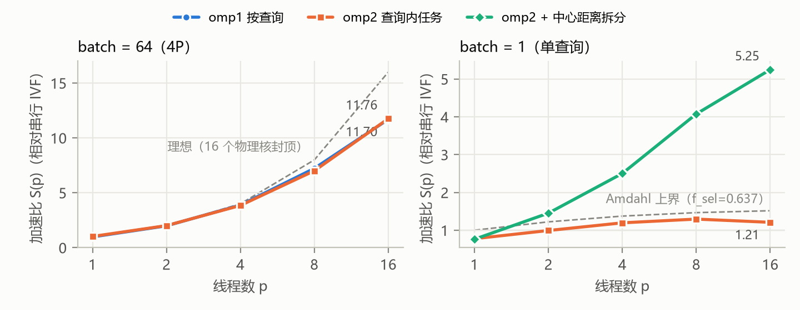
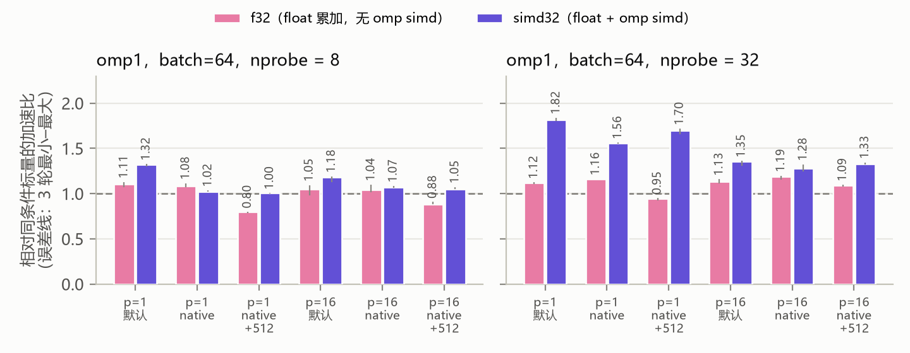
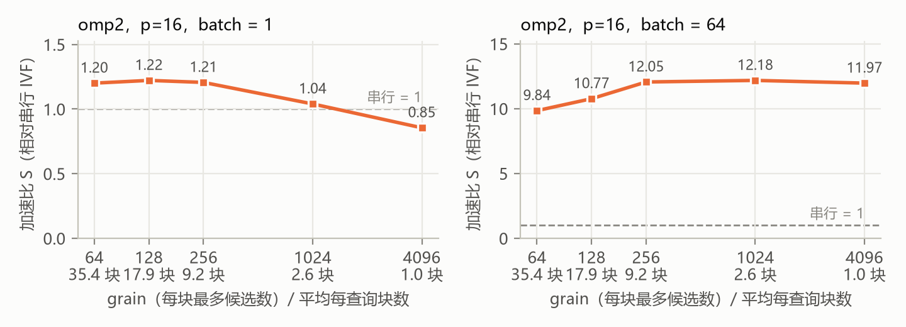
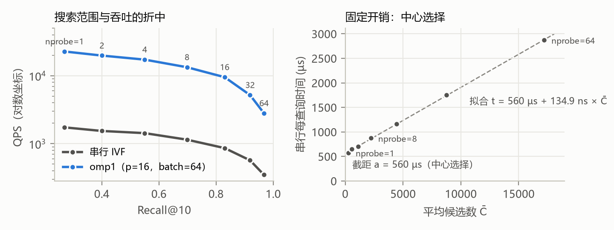

\begin{center}
{\Large\bfseries 实验二：OpenMP IVF-Flat 向量检索　实验报告}\\[3pt]
姓名：杨清徽　　学号：2024201584　　2026 年 11 月
\end{center}

**摘要**　本实验在课程实验服务器上，用官方 SIFT1M 数据与 IVF4096 索引（`/var/dataset`）实现并比较两种 OpenMP 检索：按查询并行（omp1）和查询内任务划分（omp2），并实现 `omp simd` 距离函数和 `std::thread` 对照。报告按两个应用场景组织：**吞吐场景**（大 batch=4P=64，看 QPS）和**延迟场景**（batch=1，看单查询响应时间）。吞吐场景下两种策略在 16 线程达到 11.7–11.8 倍，按查询并行已经足够，剩下的损失来自线程之间的相互干扰；延迟场景下，omp2 被串行的中心选择（占 63.7%）限制在 1.3 倍以内，把中心距离也拆成任务后可达 5.25 倍（探索）。SIMD 在单线程时快 1.32–1.82 倍；每次调用都新建线程的 `std::thread` 要多付约 2.2 ms。服务器上 perf 不可用，改用 GNU time 差分。

# 1　平台、数据与工作量构成

**平台**：课程服务器，Intel Xeon Gold 5218 虚拟机，32 个 vCPU（lscpu 显示 32 核×1 线程，是虚拟拓扑），49 GB 内存，Ubuntu 22.04，g++ 11.4.0 + libgomp。确定 P 的探针：只受计算限制的 omp1（nprobe=1，batch=128），$S$ 在 16、24、32 线程时为 12.38、14.65、15.31，$S(32)/S(16)=1.24$，说明 32 个 vCPU 是 16 个物理核的超线程，**取 P=16**，大 batch 为 64。顺序读带宽（512 MiB）为 9.9 GB/s（p=1）、49.2 GB/s（p=16），峰值 53.4 GB/s（p=24）。

**数据**：`/var/dataset` 中的 SIFT1M（$N=10^6$，d=128，10,000 个查询，1000-NN ground truth）与 faiss 训练的 4096 个中心。列表长度最短 66、中位数 227、平均 244、最长 1257，无空列表。实验取前 Q=1024 个查询，k=10，nprobe=8。坐标是 0–218 的整数；前 100 名内出现等距的查询占 76%，所以等距在这份数据上是常态，Top-k 必须严格按 $(distance,id)$ 全序处理。

**工作量构成**（单线程，每查询计时 5 次取中位数）：一个查询分两段，先算 4096 个中心距离选出 nprobe 个列表（中心选择），再扫描这些列表的 $C(q)$ 个候选。每个中心约 127 ns，每个候选约 133 ns，相差不到 5%，标量 double 距离受累加依赖链限制，是计算瓶颈。中心选择与 nprobe 无关，是每个查询的固定开销，nprobe=8 时占 **63.7%**。

| nprobe | $C(q)$：中位数 / 最大 / 平均 | 中心选择 (ms) | 扫描 (ms) | 占比 $f_{sel}$ |
|------|----------------------|----------|----------|--------|
| 1 | 248 / 1257 / 283 | 542.2 | 40.4 | 0.931 |
| 8 | 2013 / 5716 / 2231 | 532.7 | 303.9 | **0.637** |
| 32 | 8124 / 15989 / 8759 | 553.7 | 1219.0 | 0.312 |

: 前 1024 个查询的分阶段墙钟时间（合计）。

由 $f_{sel}$ 可以在实验前推出三条上界，后文逐一检验：

| # | 预测（依据） | 实测 | 判定 |
|--|----------------------------------------------------|----------------------|------|
| K1 | 延迟场景下合规的 omp2：$S(16)\le 1/(f_{sel}+(1-f_{sel})/16)=1.52$ | 最高 1.29（p=8），p=16 时 1.21 | 成立 |
| K2 | nprobe 从 8 降到 1，串行 QPS 只升 $836.6/582.6=1.44$ 倍 | 1.52 倍 | 基本成立 |
| K3 | 单线程 SIMD 只加速扫描，nprobe=8 时整体 $\le 1/f_{sel}=1.57$ 倍 | 1.32 倍 | 成立 |

: 由工作量构成推出的上界。

# 2　实现

**omp1**：`parallel for schedule(runtime)`，每个查询独立完成全部步骤，团队大小为 $\min(p,\text{batch})$。调度消融（p=16，batch=64）：static 101.5 ms，guided 84.7 ms，dynamic:4 102.1 ms，**dynamic:1 78.2 ms**（选用）。

**omp2**：每次 batch 调用只建一个团队，由 `parallel`+`single` 为每个查询生成任务 $T_q$。$T_q$ 依次：① 调用公共的 `select_lists`；② 把选中的列表首尾相接成虚拟区间 $[0,C)$，用前缀和 `off[]` 定位；③ 按 grain 切块（块可跨列表，长列表也会被拆开，每个候选恰好计算一次）；④ 用 `taskloop grainsize(1)` 为每块生成任务，块内维护局部 `TopK`，写入 `part[b·k,(b+1)·k)`；⑤ taskloop 的隐式 taskgroup 结束后由 $T_q$ 合并（跳过 id=−1 的填充项）。**每块保留 k 个就够**：若 $e$ 在全局前 k 名，比它更好的元素不超过 $k-1$ 个，块内自然也不超过，故 $e$ 必在本块前 k 名（前提：$(distance,id)$ 为全序、id 唯一）。**数据归属**：`lists`、`off`、`part` 由 $T_q$ 持有；块任务只读前两者，块 $b$ 只写自己的 k 个位置；$T_q$ 在 taskloop 结束后读取，返回时释放。**陷阱**：这些局部变量在嵌套 taskloop 中默认是 firstprivate，会被每块复制一份、写入丢失，所以代码用 `default(none)`，只把裸指针 firstprivate 进去。块数增加的代价是临时空间（块数×k×16 B，每查询最多 5.7 KB）、合并（块数×k 次插入）和任务调度，前两者很小，主要是调度（§3.3）。

**omp2+拆分（探索）**：4096 个中心每 256 个一块拆成任务，仍用公共的 `l2_distance_scalar` 计算，再用同一个全序比较器 `better` 做 `partial_sort`。选出的列表与 `select_lists` 逐项相同、完整检查全部通过，但没有直接调用 `select_lists`，所以只作为探索。

**SIMD**：`--dist` 切换候选距离（取值写入 CSV）：scalar（公共函数，double）、f32（float 累加，无 `omp simd`）、simd64、simd32（double / float + `omp simd reduction`）；Top-k 更新放在距离函数之外。float32 是精确的：每项 ≤ $218^2$，128 维之和 ≤ $6.08\times10^6<2^{24}$，且每项非负，任意累加顺序的部分和都是 float 能精确表示的整数，结果与 double 逐位相同；该前提在计时之外检查，不满足就拒绝使用。

**std::thread**：每次调用新建 $\min(p,\text{batch})-1$ 个线程，返回前 join，区间划分与 libgomp 的 static 相同，只用公共的中心选择和标量距离。**omp3**：每个候选都进 `critical` 更新共享 Top-k，作为反面对照。

**比较条件**：统一 `-O3 -std=c++17 -fopenmp -pthread`，不加 `-ffast-math`（`-march=native` 只在 SIMD 实验中作对照）；不绑核。计时只包住检索函数调用（含线程管理与同步），$S$ 的分母始终是串行 IVF。每个配置单独一个进程，预热 1 次、正式 10 次取中位数，共 3 轮，取各轮中位数的中位数；配置顺序随机，每个进程启动前要求其他用户的可运行进程数 ≤ 2（服务器多人共用）。

**正确性**：`student_tests` 在 5 组小数据上（空列表、候选不足 k、大量等距、超长列表、非整数坐标）覆盖全部策略、距离开关、线程 {1,2,3,7,16,24}、batch {1,2,5,Q}、grain、cutoff、k=1、nprobe=1 与 nprobe=nlist，**8950 种配置**与串行逐位相同（距离和 id 都用 `==` 比较），ASan+UBSan 构建同样通过。官方数据上线程数 × batch × nprobe × 距离的 **101 次完整检查全部 PASS**（ASan 构建同样），`-march=native` 两种构建另有 12 次检查全部 PASS；`--only exact` 的 Recall@10 为 1。并行版本的 Recall 与串行相同（Q=1024 时 0.698）。

# 3　吞吐场景：大 batch（4P = 64）

{width=80%}

**3.1　线程扩展。** 两种策略几乎重合：p=8 时 $S$ 为 7.23 / 7.01，p=16 时 **11.70 / 11.76**（QPS 约 13,300，$E\approx0.73$）。损失不在负载均衡：统计构建显示 p=16 时各线程忙碌时间的 max/mean 只有 1.045，但 16 个线程的工作时间之和是串行的 1.275 倍，各线程速度相差 1.21 倍。只算中心（2 MB 常驻缓存）时同样慢 1.49 倍，所以不是内存带宽；推测是虚拟机看不到超线程拓扑，部分线程共用物理核。超过 16 线程后收益很小（$S(32)=15.3$）。

**3.2　查询工作量分布（实验 B）。** 同一查询池按原始顺序、$C(q)$ 升序、降序排列（ground truth 同步重排）。先用 P0 的逐查询工作量建立"线程同速"的调度模型做对照。

| T (ms)：原始 / 升序 / 降序 | batch=64（16 个 batch） | batch=1024（单个 batch） |
|----------------|------------------|------------------|
| omp1 static | 102.5 / 93.2 / 93.8 | 84.3 / 82.8 / 85.4 |
| omp1 dynamic:1 | 75.4 / 73.8 / 72.6 | 65.4 / 65.5 / 66.3 |
| omp2 | 73.3 / 74.4 / 74.4 | 66.8 / 66.0 / 66.8 |

: 实验 B（3 轮中位数）。各线程候选数之和恒为 2,284,581，等于总候选数。

多个 batch 时，排序让每个 batch 内的查询工作量接近，static 快 9%（3 轮方向一致；模型预测 7.5%），工作量不均从 1.10 降到 1.06。单个 batch 时，模型预测排序后 static 慢 26%（最后一个线程拿到最重的 64 个查询，工作量不均从 1.17 升到 1.97），实测却与原始顺序相当；统计显示这个最重的线程在其他线程结束后独自运行，每个候选快约 10%，只能解释一部分差距，其余原因尚未查明。dynamic 与 omp2 对顺序不敏感：时间不均衡只有 1.00–1.07，快线程自动多领工作。单个 batch 比 16 个 batch 快约 13%（65 对 75 ms），省去了 15 次 batch 之间的同步和尾部空等。

**3.3　任务大小（实验 C）。** omp2、p=16，grain 取 64 / 128 / 256 / 1024 / 4096（平均每查询 35.4 / 17.9 / 9.2 / 2.6 / 1.04 块）时 $S$ 为 9.84 / 10.77 / 12.05 / **12.18** / 11.97。查询之间已有足够并行，块太小只会增加任务开销（grain=64 时慢 24%），取 1024。

**3.4　搜索范围（实验 D，图见附录 C）。** nprobe 取 1 / 8 / 32 / 64 时 Recall@10 为 0.269 / 0.698 / 0.919 / 0.968。nprobe 从 8 降到 1，候选数降为 1/8，串行 QPS 只升 1.52 倍（K2），Recall 却跌到 0.27；拟合 $t=560\,\mu s+134.9\,\text{ns}\cdot\bar C$ 推出 $f_{sel}=0.650$，与分阶段计时的 0.637 一致。这部分提速来自搜索范围缩小，与并行无关。nprobe 越大 omp1 的 $S$ 越低（13.1→8.1），nprobe=32、64 时候选读带宽为 23.3、24.7 GB/s，只有 16 线程读带宽的一半，所以不是带宽饱和；推测扫描阶段对访存延迟和超线程共享更敏感。

**3.5　SIMD 与 std::thread。** p=16 时 simd32 使吞吐提高 1.18 倍（nprobe=8）和 1.35 倍（nprobe=32），比单线程时的收益小（§4.3），nprobe=32 时候选读带宽 30.5 GB/s，约为 16 线程峰值的 62%。`std::thread` 与 omp1-static 划分方式相同：batch 为 16 / 64 / 256 时分别用 233.3 / 156.2 / 113.5 ms 和 94.1 / 103.3 / 101.8 ms，过原点回归得到每次调用多 **2.2 ms**，batch=16 时慢 2.5 倍。OpenMP 的线程池让短任务不必反复建线程，`schedule` 让动态调度只改一个参数；需要自己管理线程生命周期、任务队列或线程间通信时（如常驻检索服务、流水线），`std::thread` 加自建线程池更灵活，但这些机制都要自己实现。

# 4　延迟场景：单查询（batch = 1）

**4.1　两种策略。** omp1 只有 1 个线程有事做，$S=0.99$。omp2 的 $S$ 在 p=1、2、4、8、16 时为 0.78、0.99、1.20、**1.29**、1.21，始终低于 Amdahl 上界（K1）：中心选择在单查询内只能串行，p=16 时反而不如 p=8。延迟 p50 / p95 从串行的 0.855 / 1.111 ms 降到 0.656 / 0.837 ms（p=8）。**探索**：把中心距离也拆成任务后，串行部分消失，$S$ 依次为 0.76、1.45、2.50、4.08、**5.25**，p=16 时 p50 / p95 为 0.162 / 0.204 ms。

**4.2　任务大小与小任务阈值。** batch=1 时 grain 取 64 / 128 / 256 / 1024 / 4096 的 $S$ 为 1.20 / **1.22** / 1.21 / 1.04 / 0.85：块太大就没有查询内并行（4096 时每个查询只剩约 1 块），所以取 128。设置"$C(q)\le$ cutoff 时不拆块"的阈值：cutoff 取 512、1024 时与 0 相差约 2%（接近噪声），取 2048、4096 时慢 15% 和 39%，因此不设阈值。critical 对照（omp3）比 omp2 慢 2.65 倍，即每个候选进一次 critical 的同步代价。

**4.3　等待策略与 SIMD。** 令 grain=4096 使每个查询只有 1 个任务、任一时刻只有 1 个线程在算：默认（自旋）时 T=1059.8 ms，计算线程每查询算 1023 µs，比串行的 827 µs 多 24%，说明另外 15 个空转线程拖慢了它；改成 `OMP_WAIT_POLICY=passive` 后更糟（2703.2 ms，每查询计算 2207 µs）：除了休眠和唤醒的开销，计算本身也变慢了，推测是刚被唤醒的 vCPU 频率或调度状态还没恢复。单线程时 simd32 整体快 1.32 倍（nprobe=8，低于 K3 的 1.57）和 1.82 倍（nprobe=32），中心选择占比越小收益越大。

{width=84%}

**向量化证据**（GCC 11.4 报告与反汇编）：默认选项下公共的 double 循环未向量化（`missed`），只有标量指令；simd32 主循环为 `subps/mulps/addps`。**去掉 `omp simd` 的 f32 仍被自动向量化**：减法和乘法打包，加法仍是按原顺序的标量 `addss`，所以"f32 对 simd32"比较的是"能否重排加法"。`-march=native` 下 simd32 只用 ymm（**zmm 为 0**，GCC 对该 CPU 默认偏好 256 位）；加 `-mprefer-vector-width=512` 后出现 zmm，nprobe=32、p=1 时收益从 1.56 升到 1.70。但按绝对时间，**默认选项最快**：nprobe=8、p=1 时 simd32 为 685 ms，native 和 native512 为 860 和 876 ms（三者的标量版本只相差 3.6%），推测是 AVX 降频拖慢了标量的中心选择。

# 5　性能工具

服务器上 `perf_event_paranoid=4`，也没有安装对应内核的 perf（`perf stat` 报 "perf not found for kernel 5.15.0-60"，原文见 `results/server/perf_unavailable.txt`）。按题目要求改用 `/usr/bin/time -v`。它统计整个进程（含加载数据和参考结果），所以每个配置分别用 `--repeats 10` 和 `--repeats 60` 各跑 3 次，中位数相减后除以 50，只留下检索部分。

| 配置（p=16） | 主动切换/调用 | 被动切换/调用 | 次缺页/调用 | CPU/查询 (µs) | 其中系统态 |
|---------------------|----------|----------|----------|----------|----------|
| 串行（batch=64） | 0 | 0.37 | 0.001 | 898 | 0.4 |
| omp1（batch=64） | 0.13 | 0.15 | 0.004 | 1196 | 0.6 |
| std::thread（batch=64） | 3.08 | 0.26 | 22.0 | 1804 | 28.5 |
| omp2 batch=1：自旋 / passive | 0.05 / 60.6 | 0.01 / 0.01 | 0.006 / 0.006 | 11534 / 4446 | 2.1 / 1021 |

: GNU time 差分（rusage 包含所有线程；最大常驻内存约 990 MB）。

**解读**：(1) omp1 的 CPU 时间是串行的 1.33 倍，其中约 1.28 倍是 §3.1 的并发减速，其余是 barrier 处的自旋。(2) std::thread 每次调用多 3.1 次主动切换和 22 次缺页（15 个新线程的栈），用户态 CPU 也明显更多，与 §3.5 的 2.2 ms/调用一致；推测新线程落在刚被唤醒的 vCPU 上，开始时算得慢。(3) batch=1 自旋时几乎没有上下文切换，但 15 个空转线程一直占着 CPU（每查询 11.5 ms CPU）；passive 每次调用 60.6 次主动切换、1 ms 系统态，即休眠和唤醒的代价。

# 6　结论

吞吐场景按查询并行即可：omp1（dynamic:1）与 omp2 在 16 线程都达到约 11.7 倍，查询之间的并行已经足够，剩下的损失主要来自线程之间相互拖慢，而动态领取能自动适应线程速度的差异。延迟场景的瓶颈是每个查询都要串行完成的中心选择，合规的查询内并行只能到 1.3 倍，再多线程反而更慢；只有把中心选择本身也并行化才能突破。

| 场景 | 推荐配置 | 依据 |
|----------------|--------------------|--------------------------|
| 吞吐（batch ≥ 4P） | omp2（grain 1024）或 omp1 dynamic:1，p=16 | $S$=11.8 / 11.7；对查询顺序不敏感 |
| 单查询，严格调用 `select_lists` | omp2，p=8，grain 128 | 最高 1.29；p=16 时降到 1.21 |
| 单查询，低延迟（探索） | omp2 + 中心距离拆分，p=16 | $S$=5.25，p50 延迟 0.162 ms |
| 距离函数 | simd32（经精确性检查），默认编译选项 | 逐位相同；p=1 快 1.32–1.82 倍；native 反而慢 |
| 高召回（nprobe ≥ 32） | omp1 + simd32，p=16 | $S$ 降到 8–9，扫描阶段并发效率较低 |
| 不推荐 | static 调度；omp3；cutoff ≥ 2048；每次调用新建线程；passive | 慢 30%、2.65 倍、15–39%、每次 2.2 ms、2.6 倍 |

: 场景推荐表（p 超过 16 时收益很小）。

**bug 与负优化**：统计插桩在 `default(none)` 下引用全局数组而编译失败；正确性脚本的计数在管道子 shell 中，退出码恒为 0；向服务器同步代码时，把 `tar xf -` 与 `nohup … &` 写在同一条 `&&` 链里，后台任务的 stdin 被重定向到 /dev/null，解包失败；负载门控最初用 load1，但它会被自己的实验抬高，改为看其他用户的可运行进程数。passive 等待、`-march=native`、小任务阈值、batch=1 时用 16 线程，都让结果变慢。**局限**：没有硬件计数器，"线程相互拖慢""唤醒后算得慢""AVX 降频"都只是推断；服务器多人共用，因此用负载门控、多轮中位数和区组设计。**扩展性**：大 batch 在 16 个物理核以内可以扩展；nprobe 增大后扫描阶段的并发效率下降；单查询要继续提速，需要常驻、唤醒快的工作线程，并把中心选择纳入并行（须保证选出的列表不变）。

# 7　AI 使用声明与参考资料

**AI 使用声明**：本实验使用了 Claude（Anthropic，通过 Claude Code 使用 Claude Opus 5.5 模型），完成了全部 OpenMP 策略、SIMD 距离和 std::thread 版本的实现，扩展 harness，编写测试、实验、统计和作图脚本，经 SSH 在课程服务器上运行实验，并起草本报告。方案决策由本人作出：把中心距离拆分作为探索、omp1 用 dynamic:1；grain 取 128（batch=1）和 1024（batch=64），不设小任务阈值；服务器 P 取 16；报告按吞吐与延迟两个场景组织，只保留三条关键预测。数据都可以由仓库中的脚本和 `results/server/` 复现，已由本人核对；对话截图见附录 F。

**参考资料**：[1] Faiss indexes，<https://github.com/facebookresearch/faiss/wiki/Faiss-indexes>；[2] OpenMP 5.2 taskloop / taskgroup / SIMD，<https://www.openmp.org/spec-html/5.2/>（openmpse74、92、60）；[3] perf-stat(1)，<https://man7.org/linux/man-pages/man1/perf-stat.1.html>；[4] H. Jégou et al. Product Quantization for Nearest Neighbor Search. TPAMI 2011，<https://doi.org/10.1109/TPAMI.2010.57>（SIFT1M 出处）；[5] GNU libgomp 手册，<https://gcc.gnu.org/onlinedocs/libgomp/>。

\newpage

# 附录

## A　线程扩展完整数据（服务器，官方数据；单元格为 T (ms) / $S$ / $E$）

| p | omp1，batch=64 | omp2，batch=64 |
|---|---|---|
| 1 | 918.8 / 0.98 / 0.98 | 880.1 / 1.03 / 1.03 |
| 2 | 453.5 / 1.99 / 1.00 | 448.9 / 2.01 / 1.01 |
| 4 | 232.6 / 3.89 / 0.97 | 234.8 / 3.85 / 0.96 |
| 8 | 125.1 / 7.23 / 0.90 | 128.9 / 7.01 / 0.88 |
| 16 | 77.3 / 11.70 / 0.73 | 76.9 / 11.76 / 0.73 |

: 吞吐场景，串行 T = 903.7 ms。超过 16 线程（只受计算限制的探针：omp1，nprobe=1，batch=128，串行 589.5 ms）：p=24 时 $S$=14.65，p=32 时 15.31。

| p | omp1 | omp2 | omp2 + 中心距离拆分 |
|---|---|---|---|
| 1 | 908.9 / 0.99（0.864/1.123） | 1160.9 / 0.78（1.096/1.448） | 1182.8 / 0.76（1.116/1.474） |
| 2 | — | 907.9 / 0.99（0.893/1.074） | 620.7 / 1.45（0.593/0.775） |
| 4 | — | 753.5 / 1.20（0.692/0.902） | 360.1 / 2.50（0.342/0.449） |
| 8 | — | 696.0 / 1.29（0.656/0.837） | 221.1 / 4.08（0.211/0.269） |
| 16 | 909.8 / 0.99（0.864/1.128） | 745.0 / 1.21（0.728/0.781） | 171.6 / 5.25（0.162/0.204） |

: 延迟场景（T ms / $S$，括号内为单查询延迟 p50/p95，ms）。串行 T = 901.0 ms，延迟 0.855/1.111 ms；omp1 只测了 p=1 和 16。

## B　实验 B 的统计与模型

| 配置 | 工作量不均 max/mean($W_t$)：原始 / 升序 / 降序 | 时间不均 max/mean：原始 / 升序 / 降序 | 模型完成时间 (ms)：原始 / 升序 / 降序 |
|---|---|---|---|
| omp1 static，batch=64 | 1.10 / 1.06 / 1.06 | 1.06 / 1.08 / 1.06 | 58.9 / 54.5 / 54.5 |
| omp1 static，batch=1024 | 1.17 / 1.97 / 1.97 | 1.15 / 1.46 / 1.18 | 55.7 / 70.4 / 70.4 |
| omp1 dynamic:1，batch=64 | 1.09 / 1.09 / 1.03 | 1.04 / 1.07 / 1.07 | 57.6 / 54.0 / 53.6 |
| omp1 dynamic:1，batch=1024 | 1.13 / 1.10 / 1.16 | 1.01 / 1.01 / 1.01 | 52.7 / 52.9 / 52.5 |
| omp2，batch=64 | 1.19 / 1.22 / 1.22 | 1.01 / 1.02 / 1.02 | — |
| omp2，batch=1024 | 1.16 / 1.09 / 1.10 | 1.00 / 1.00 / 1.00 | — |

: 统计构建（另跑一遍，不计入正式计时；3 次重复取中位数）与线程同速的调度模型（用 P0 的逐查询工作量，理想下界 52.3 ms）。

## C　实验 C、D 的图

{width=84%}

{width=84%}

## D　读带宽与 SIMD 完整数据

顺序读带宽（512 MiB，GB/s）：p=1 时 9.9，p=4 时 25.7，p=8 时 40.3，p=16 时 49.2，p=24 时 53.4。

| 编译选项 | p | nprobe | 标量 (ms) | f32 / 标量 | simd32 / 标量 | simd32 (ms) |
|---|---|---|---|---|---|---|
| default | 1 | 8 | 906.0 | 1.106 | 1.323 | 684.9 |
| default | 1 | 32 | 1810.7 | 1.118 | 1.815 | 985.9 |
| default | 16 | 8 | 76.8 | 1.052 | 1.183 | 66.9 |
| default | 16 | 32 | 200.9 | 1.131 | 1.352 | 150.6 |
| native | 1 | 8 | 882.4 | 1.082 | 1.023 | 859.5 |
| native | 1 | 32 | 1824.2 | 1.160 | 1.556 | 1171.1 |
| native | 16 | 8 | 78.1 | 1.044 | 1.068 | 73.0 |
| native | 16 | 32 | 202.5 | 1.189 | 1.279 | 156.3 |
| native512 | 1 | 8 | 874.6 | 0.796 | 1.005 | 876.3 |
| native512 | 1 | 32 | 1979.4 | 0.948 | 1.695 | 1180.3 |
| native512 | 16 | 8 | 78.6 | 0.883 | 1.051 | 74.8 |
| native512 | 16 | 32 | 208.7 | 1.087 | 1.329 | 157.0 |

: omp1，batch=64，区组设计，3 轮中位数。native512 为 `-march=native -mprefer-vector-width=512`。

## E　正确性运行截图

（待本人在服务器上运行后截图插入。文字版：`results/server/correctness_run.txt`；完整检查矩阵：`results/server/e0_correctness_official.txt`（101 次全部 PASS），ASan 构建：`results/server/e0_correctness_official_asan.txt`。）

## F　AI 对话截图

（待本人插入。）

## G　复现命令（课程服务器上，`IVF_DATA=/var/dataset`）

```
make && make student_test && make student_test_asan
bash scripts/check_correctness.sh ./ivf_lab results/server/e0_correctness_official.txt
bash scripts/server_S1.sh       # 确定 P、native 构建检查
bash scripts/server_S2S3.sh     # 线程扩展、统计构建、GNU time 差分
bash scripts/server_S4S6.sh     # 读带宽、向量化报告、SIMD、std::thread
bash scripts/server_supp.sh     # P0、调度、实验 B/C/D、ASan
IVF_RESULTS=results/server python3 -I scripts/bench.py S2b --rounds 3
```

汇总与作图（需要 pandas、matplotlib）：`IVF_RESULTS=results/server python -I scripts/summarize.py <实验名>`，`IVF_RESULTS=results/server python -I scripts/plot.py A C D E`。所有命令与原始输出记录在 `实验日志.md` 和 `results/server/` 中。
